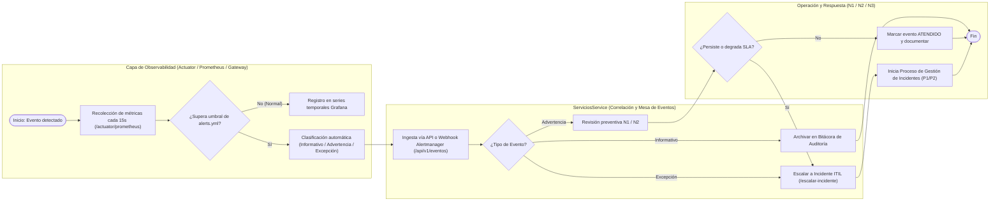
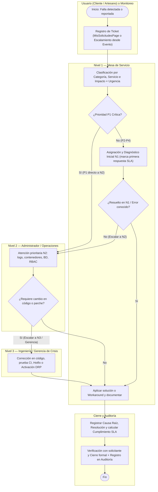

# Plan Integral de Operación de Servicios — Arte Andino (ITIL 4)
## Monitoreo y Gestión de Eventos · Gestión de Incidentes · Continuidad y Recuperación ante Desastres (BCP/DRP)

**Proyecto:** Plataforma E-Commerce de Artesanías de Alto Valor *Arte Andino*  
**Arquitectura:** Microservicios Spring Boot 4.1.1 / Java 25 (`apigateway`, `configserver`, `discoveryserver`, `authservice`, `productosservice`, `ventasservice`, `pagosservice`, `logisticaservice`, `gerenciaservice`, `serviciosservice`) + PostgreSQL 16 (7 BDs aisladas) + Frontend React 19 / Vite 8.  
**Actores del Sistema:** Cliente, Artesano, Administrador y Gerencia.

---

# PARTE I — PROCEDIMIENTO DE MONITOREO Y GESTIÓN DE EVENTOS

## 1. Objetivo
Establecer un procedimiento estandarizado para detectar, clasificar, correlacionar y atender oportunamente los eventos generados por la infraestructura y los microservicios de *Arte Andino*, transformando anomalías críticas en incidentes gestionados antes de que afecten la continuidad comercial.

## 2. Clasificación de Eventos (ITIL 4)
Implementada en `serviciosservice` (`TipoEvento.java`, `EventoMonitoreoController.java` y `monitoring/alerts.yml`):

| Clasificación | Código | Descripción | Ejemplos en Arte Andino | Acción Inmediata |
|---|---|---|---|---|
| **Informativo** | `EVI-*` | Operación normal registrada para trazabilidad y auditoría. | Despliegue exitoso en Oracle Cloud, backup diario completado (`backup.sh`), inicio correcto de microservicio. | Registro automático en `evento_monitoreo` y `registro_auditoria`. Sin alerta humana. |
| **Advertencia** | `EVA-*` | Acercamiento a un umbral de capacidad o anomalía no bloqueante. | Latencia HTTP `p95 > 500ms` por 3m, JVM Heap `> 80%` por 5m, incremento de HTTP `401/423/429`. | Notificación a N1/N2, análisis preventivo en Grafana, verificación de caché/pool HikariCP. |
| **Excepción** | `EVX-*` | Falla activa, caída de servicio o degradación crítica del negocio. | `up == 0` (microservicio caído > 1m), tasa de errores `5xx > 5%`, fallo de conexión a PostgreSQL. | Escalamiento inmediato a **Incidente P1/P2** (`POST /api/v1/eventos/{id}/escalar-incidente`) y activación de respuesta. |

## 3. Diseño del Proceso y Flujo de Atención de Eventos (BPMN)

## 4. Identificación de Incidentes desde Eventos
Un evento se convierte formalmente en **Incidente** cuando cumple cualquiera de estas reglas de correlación:
1. Un evento clasificado como **EXCEPCIÓN** (`ServicioCaido`, `TasaErrores5xxAlta`) se mantiene activo más allá de su ventana de tolerancia (`for: 1m–2m`).
2. Se repiten **3 o más eventos de ADVERTENCIA** del mismo microservicio en un periodo de 15 minutos (ej. `LatenciaAltaP95` recurrente).
3. Un operador de N1/N2 ejecuta el escalamiento directo desde el **Centro de Operaciones ITIL** (`POST /api/v1/eventos/{id}/escalar-incidente`), lo cual crea automáticamente un ticket `INC-YYYY-XXXXX`, calcula su prioridad mediante la Matriz Impacto × Urgencia y registra la trazabilidad en `registro_auditoria`.

## 5. Matriz de Priorización (Impacto × Urgencia)
Implementada en código en `PrioridadSolicitud.calcularPorMatriz(impacto, urgencia)` y `src/lib/itil.js`:

| Impacto \ Urgencia | **ALTA** (Inmediata) | **MEDIA** (En el día) | **BAJA** (Planificable) |
|---|---|---|---|
| **ALTO** (Múltiples usuarios / Ventas / Pagos) | **P1 — CRÍTICA** | **P2 — ALTA** | **P3 — MEDIA** |
| **MEDIO** (Un proceso / Módulo interno) | **P2 — ALTA** | **P3 — MEDIA** | **P4 — BAJA** |
| **BAJO** (Usuario individual / Consulta) | **P3 — MEDIA** | **P4 — BAJA** | **P4 — BAJA** |

## 6. Políticas de Monitoreo de Eventos
- **Frecuencia de muestreo:** `scrape_interval: 15s` en Prometheus contra los 9 servicios instrumentados con Actuator + Micrometer.
- **Trazabilidad extremo a extremo:** Cada petición recibe un `X-Correlation-Id` en `apigateway` para correlacionar logs entre microservicios.
- **Umbrales vigentes (`monitoring/alerts.yml`):**
  - `ServicioCaido`: `up == 0` por `1m` (EXCEPCIÓN / P1).
  - `TasaErrores5xxAlta`: errores `5xx > 5%` por `2m` (EXCEPCIÓN / P1–P2).
  - `LatenciaAltaP95`: `p95 > 500ms` por `3m` (ADVERTENCIA / P2–P3).
  - `UsoHeapJvmAlto`: Heap `> 80%` por `5m` (ADVERTENCIA / P3).
  - `PosibleAtaqueFuerzaBruta`: tasa de `401/423/429 > 0.5 req/s` por `2m` (ADVERTENCIA SEGURIDAD).
- **Retención y rotación:** Logs Docker limitados (`max-size: 10m`, `max-file: 3`) y bitácora inmutable en PostgreSQL (`serviciosdb`).

## 7. Plan de Respuesta ante Eventos
| Evento Detectado | Responsable | Acción Inmediata (Contención) | Verificación |
|---|---|---|---|
| `ServicioCaido` | N2 Administrador | Revisar `docker compose ps` y logs; reiniciar servicio o activar rollback CI. | `/actuator/health` devuelve HTTP 200. |
| `TasaErrores5xxAlta` | N2 -> N3 Ingeniería | Revisar `X-Correlation-Id` en logs, verificar conexión a BD y revertir último cambio si coincide con deploy. | Tasa 5xx `< 1%` durante 10 min. |
| `LatenciaAltaP95` | N2 Operaciones | Revisar conexiones activas HikariCP, caché Caffeine y consultas lentas. | `p95 < 500ms` en Grafana y k6. |
| `PosibleAtaqueFuerzaBruta` | N2 Seguridad | Confirmar activación de `RateLimitFilter` (429) y bloqueo de cuenta (423); bloquear IP en firewall Oracle Cloud. | Caída de tasa 401/429 a nivel basal. |

## 8. Herramientas Recomendadas y Mejora Operativa
- **Stack implementado:** Spring Boot Actuator, Micrometer, Prometheus (`v3.2.1`), Grafana (`11.5.2`) con dashboard preprovisionado `arteandino-capacidad.json`, k6 para pruebas de carga y `serviciosservice` para gestión centralizada.
- **Recomendaciones de mejora continua:** Integrar Alertmanager con canal de Telegram/Slack/Email para notificaciones push 24/7, agregar Loki para centralización de logs JSON y ejecutar pruebas k6 automáticas en ambiente staging antes de cada release mayor.

---

# PARTE II — PLAN DE GESTIÓN DE INCIDENTES (ITIL 4)

## 1. Caso de Estudio y Contexto
*Arte Andino* comercializa piezas artesanales de alto valor (textilería en alpaca, cerámica, joyería y tallado). Una interrupción en el catálogo, carrito, pasarela de pago o seguimiento logístico impacta directamente la confianza del comprador y los ingresos de los artesanos. Por ello se implementa un flujo formal de Gestión de Incidentes integrado en la propia plataforma (`serviciosservice` + **Centro de Operaciones ITIL**).

## 2. Identificación y Clasificación de Incidentes
Cada incidente (`INC-YYYY-XXXXX`) se clasifica obligatoriamente por:
- **Categoría:** `FALLA_PLATAFORMA`, `PAGO_Y_FACTURACION`, `RECLAMO_ENVIO`, `INCIDENTE_OPERATIVO`, `SEGURIDAD_ACCESO`.
- **Servicio afectado:** `apigateway`, `authservice`, `ventasservice`, `pagosservice`, `productosservice`, `logisticaservice`, `gerenciaservice`, `postgres`.
- **Impacto y Urgencia:** Calcula automáticamente la prioridad **P1–P4** y sus vencimientos SLA.
- **Documentación de cierre:** Registra `solucionTemporal` (Workaround), `causaRaiz` y `respuestaResolucion`.

## 3. Flujo de Atención de Incidentes en Notación BPMN

## 4. Definición de Roles y Responsabilidades
| Rol / Nivel | Actor en Arte Andino | Responsabilidades Clave |
|---|---|---|
| **Nivel 1 — Mesa de Servicio** | Soporte / Operador | Recibir tickets, validar datos, clasificar categoría/servicio, aplicar soluciones conocidas y registrar primera respuesta SLA. |
| **Nivel 2 — Administrador Técnico** | `ADMINISTRADOR` | Atender incidentes P1/P2, revisar salud de contenedores/Eureka/Grafana, gestionar accesos RBAC, reiniciar servicios o ejecutar respaldos. |
| **Nivel 3 — Ingeniería / Desarrollo** | Equipo DevOps / Backend-Frontend | Investigar causa raíz en código Java/React, aplicar hotfix con pruebas CI y desplegar actualización controlada. |
| **Gestor de Incidentes / Crisis** | `GERENCIA` | Supervisar cumplimiento global de SLA, coordinar comunicación en incidentes P1 y autorizar activación del DRP. |

## 5. Definición de Acuerdos de Nivel de Servicio (SLA)
Medidos automáticamente por `SolicitudServiceImpl.java` (`fechaLimiteRespuestaSla`, `fechaLimiteSla`, `slaRespuestaCumplido`, `slaCumplido`):

| Prioridad | Nivel | Tiempo Máx. Primera Respuesta | Tiempo Máx. Resolución | Escalamiento Inicial | Meta Cumplimiento |
|---|---|---|---|---|---|
| **P1 — CRÍTICA** | Crítico | **15 minutos** | **2 horas** | `N2_ADMINISTRADOR` -> `GERENCIA_CRISIS` | ≥ 98% |
| **P2 — ALTA** | Alto | **30 minutos** | **8 horas** | `N1_MESA_SERVICIO` -> `N2_ADMINISTRADOR` | ≥ 95% |
| **P3 — MEDIA** | Medio | **2 horas** | **24 horas** | `N1_MESA_SERVICIO` | ≥ 92% |
| **P4 — BAJA** | Bajo | **4 horas** | **72 horas** | `N1_MESA_SERVICIO` | ≥ 90% |

---

# PARTE III — PLAN DE CONTINUIDAD DEL SERVICIO Y RECUPERACIÓN ANTE DESASTRES (BCP / DRP)

## 1. Clasificación e Identificación de Servicios Críticos y Objetivos RTO / RPO
Publicado en vivo en `GET /api/v1/continuidad/plan` y visible en la pestaña **Continuidad y DRP** del panel Admin/Gerencia:

| Servicio | Criticidad | Función de Negocio | RTO (Tiempo Máx. Recuperación) | RPO (Pérdida Máx. de Datos) |
|---|---|---|---|---|
| `apigateway` | **Tier 1 — Crítico** | Enrutamiento único, JWT, RBAC, Rate Limiting y cabeceras OWASP | **15 min** | **0 min** (stateless) |
| `postgres` | **Tier 1 — Crítico** | Persistencia de las 7 BDs del negocio | **30 min** | **15 min** |
| `authservice` | **Tier 1 — Crítico** | Login, emisión JWT, bloqueo por fuerza bruta y gestión de actores | **15 min** | **15 min** |
| `ventasservice` | **Tier 1 — Crítico** | Catálogo comercial, carrito, pedidos y campañas | **30 min** | **15 min** |
| `pagosservice` | **Tier 1 — Crítico** | Pagos, comprobantes y reembolsos | **30 min** | **5 min** |
| `productosservice` | **Tier 2 — Alto** | Productos artesanales, categorías, materiales y producción | **1 hora** | **1 hora** |
| `logisticaservice` | **Tier 2 — Alto** | Almacenes, inventario, proveedores, transportistas y envíos | **1 hora** | **1 hora** |
| `configserver` / `discoveryserver` | **Tier 2 — Alto** | Configuración centralizada y registro Eureka | **15 min** | **0 min** (código en Git) |
| `serviciosservice` | **Tier 3 — Medio** | Mesa ITIL, monitoreo de eventos, incidentes y auditoría | **2 horas** | **1 hora** |
| `gerenciaservice` | **Tier 3 — Medio** | KPIs, presupuestos, decisiones estratégicas y reportes | **4 horas** | **24 horas** |

## 2. Análisis de Riesgos de Continuidad
| Código | Escenario de Riesgo | Probabilidad | Impacto | Controles y Mitigación Implementada |
|---|---|---|---|---|
| `R-01` | Caída o corrupción de PostgreSQL | Media | Crítico | Volumen persistente + backups 3-2-1 (`postgres/backup.sh`) + restauración probada (`postgres/restore.sh`). |
| `R-02` | Caída de la VM en Oracle Cloud | Baja | Crítico | Infraestructura como código (`docker-compose.yml` + GitHub Actions), redespliegue completo en nueva instancia en < 30 min. |
| `R-03` | Ataque DDoS / Fuerza bruta contra Login | Alta | Alto | `RateLimitFilter` (429), bloqueo por 3 intentos fallidos por 1h (423), cabeceras OWASP y CORS restringido. |
| `R-04` | Agotamiento de memoria JVM o pool de BD | Media | Alto | Límites RAM por contenedor (`384M–512M`), `-XX:MaxRAMPercentage=75.0`, HikariCP máx. 10 conexiones y alertas Prometheus. |
| `R-05` | Regresión tras despliegue en producción | Media | Alto | CI obligatorio con pruebas reales (sin `-DskipTests`), smoke tests post-deploy y rollback por commit en Git. |

## 3. Estrategia de Alta Disponibilidad (HA)
- **Aislamiento de fallas (Bulkhead):** Cada microservicio corre en su propio contenedor no-root con límite de memoria y su propia base de datos lógica, evitando que una saturación en `gerenciaservice` tumbe `ventasservice`.
- **Arranque resiliente y auto-recuperación:** Todos los servicios incorporan `HEALTHCHECK` contra `/actuator/health`, `restart: unless-stopped` y dependencia ordenada (`condition: service_healthy`).
- **Desempeño y tolerancia a picos:** Caché Caffeine en `productosservice` (60s), eliminación del N+1 en `PedidoServiceImpl.listarPorArtesano`, timeouts explícitos de Feign (`connect: 3s`, `read: 8s`) y frontend estático distribuido globalmente vía CDN en Vercel con code splitting WPO.

## 4. Plan de Respaldos (Estrategia 3-2-1)
- **3 copias de los datos:** Base activa en volumen Docker `postgres_data`, respaldo diario local comprimido (`.sql.gz`) y copia externa cifrada en almacenamiento de objetos (Oracle Object Storage / nube externa).
- **2 medios distintos:** Disco de volumen persistente + Object Storage externo.
- **1 copia fuera del sitio (Off-site):** Protege ante pérdida total de la VM de producción.
- **Automatización:** Cron diario a las 02:00 ejecutando `./postgres/backup.sh ./backups` con retención rotativa de 14 días.
- **Verificación DRP:** Simulacro mensual ejecutando `./postgres/restore.sh ./backups <TIMESTAMP>`, midiendo automáticamente el tiempo real de restauración frente al objetivo **RTO ≤ 30 min**.

## 5. Resultados Esperados
- **Disponibilidad mensual del servicio:** ≥ **99.5%**.
- **Cumplimiento de SLA de incidentes:** ≥ **95%** en respuesta y resolución.
- **Recuperación verificada:** **RTO ≤ 30 minutos** y **RPO ≤ 15 minutos** para servicios Tier 1.
- **Trazabilidad total:** 100% de eventos críticos, cambios de acceso y resoluciones auditados en `registro_auditoria`.

---

# PARTE IV — GUÍA RÁPIDA PARA RESPONDER AL DOCENTE EN LA SUSTENTACIÓN

1. **Si pregunta: *"¿Cómo clasifican los incidentes?"***  
   -> Responde: *"Los clasificamos con ITIL 4 en dos dimensiones: primero por **Tipo y Categoría** (`INCIDENTE`, `SERVICIO`, `INFORMACION/ARCO`, `ACCESO` y servicio afectado), y segundo calculamos automáticamente su **Prioridad (P1 Crítica a P4 Baja)** mediante la **Matriz Impacto × Urgencia** implementada en el backend (`PrioridadSolicitud.calcularPorMatriz`) y visible en vivo en el formulario del cliente/artesano."*
2. **Si pregunta: *"¿Cómo pasan de un evento de monitoreo a un incidente y cómo lo resuelven?"***  
   -> Responde: *"Prometheus recolecta métricas cada 15 segundos desde `/actuator/prometheus` y evalúa reglas en `monitoring/alerts.yml` (Informativo, Advertencia, Excepción). Cuando detectamos una Excepción o falla, en nuestro **Centro de Operaciones ITIL** (`/admin/servicios`) presionamos **Escalar a Incidente**, lo que crea automáticamente el ticket `INC-*`, asigna SLA de respuesta y resolución, permite escalar `N1 -> N2 -> N3 -> Gerencia de Crisis` y obliga a documentar **Workaround**, **Causa Raíz** y **Resolución**, quedando todo trazado en la Bitácora de Auditoría."*
3. **Si pregunta: *"¿Cómo garantizan continuidad y qué pasa si se cae la base de datos?"***  
   -> Responde: *"Clasificamos nuestros 10 servicios en **Tier 1, 2 y 3** con **RTO ≤ 30 min** y **RPO ≤ 15 min** para los críticos. Aplicamos la **regla de respaldos 3-2-1** con `postgres/backup.sh` diario y `postgres/restore.sh` probado para restaurar las 7 bases de datos midiendo el tiempo real de recuperación. Además todos los contenedores tienen `HEALTHCHECK`, límites de RAM y redespliegue automatizado por GitHub Actions."*
